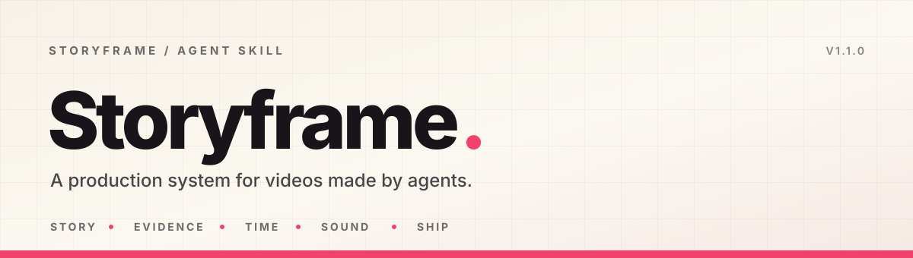
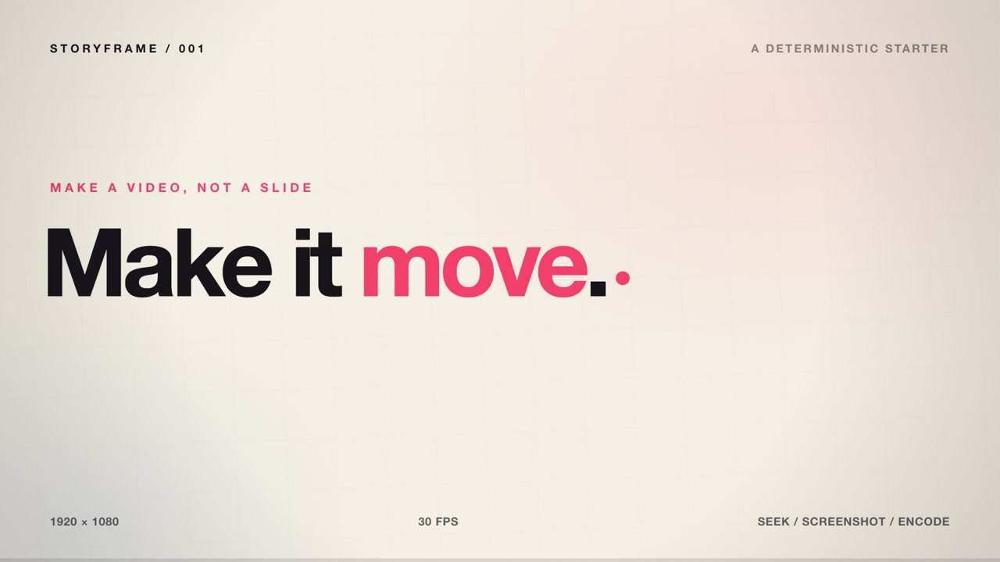
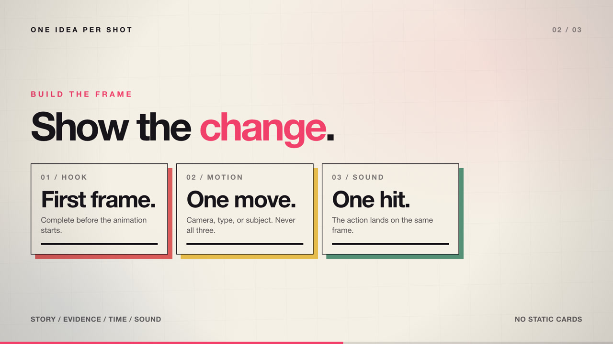
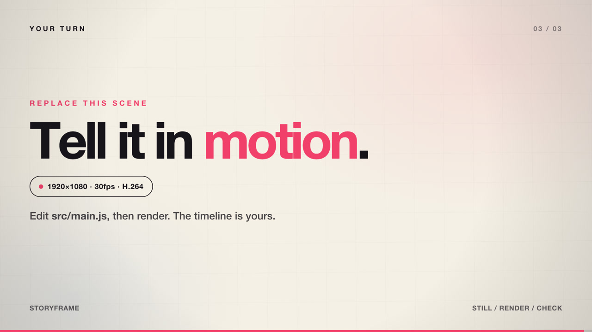

<div align="center">
  
  <h1>Storyframe Video Skill</h1>
  <p><strong>把视频当成一个工程，而不是会动的 PPT。</strong><br />
  故事 · 证据 · 时间 · 声音 · 验收</p>
  <p>
    <a href="CHANGELOG.md"></a>
    <a href="LICENSE"></a>
    
    
    
    <a href="https://github.com/nexsjournal/storyframe-video/actions/workflows/check.yml"></a>
  </p>
  <p>
    <a href="#快速开始">快速开始</a> ·
    <a href="#工作流">工作流</a> ·
    <a href="#六种模式">六种模式</a> ·
    <a href="#风格库">风格库</a> ·
    <a href="#示例">示例</a> ·
    <a href="#faq">FAQ</a>
  </p>
</div>

---

**Storyframe** 是一个面向 AI Agent 的视频生产 Skill。它不负责“生成一段会动的画面”，而是把一支片子拆成可以被执行、被检查、被复现的工程：

- **故事**：观众看完记住哪一句话？
- **证据**：每个产品功能、数据、日期、场地，来源在哪？
- **时间**：镜头、动作、字幕、音乐卡点是否对齐？
- **声音**：音乐、口播、音效是否在同一条叙事线上？
- **验收**：首帧、黑帧、响度、字幕、CTA 是否真的过了一遍？

默认交付不是“几个创意”，而是 **MP4 + 封面 + SRT + 可复现工程 + 验收报告**。

> 适用于：产品推广、功能发布、知识讲解、口播优化、活动宣传、课程演示、音乐 MV。
> 默认画幅：16:9 / 9:16 / 1:1 / 4:5；常见时长 15–180 秒（MV 跟随歌曲长度）。

---

## 目录

- [为什么是 Storyframe](#为什么是-storyframe)
- [你能得到什么](#你能得到什么)
- [六种模式](#六种模式)
- [风格库](#风格库)
- [工作流](#工作流)
- [快速开始](#快速开始)
- [怎么用：推荐姿势](#怎么用推荐姿势)
- [项目结构](#项目结构)
- [工具链](#工具链)
- [质量门禁](#质量门禁)
- [示例](#示例)
- [素材与工具](#素材与工具)
- [设计原则](#设计原则)
- [FAQ](#faq)
- [Contributing](#contributing)
- [License](#license)
- [Credits](#credits)

---

## 为什么是 Storyframe

普通“AI 视频”最容易出的五个问题，以及 Storyframe 的对应做法：

| 问题 | 常见结果 | Storyframe 的做法 |
|---|---|---|
| 首帧是空白/半成品 | 平台缩略图废掉，点击率低 | 首帧先做成完整画面，再播动画；自动检查首帧 ink 比例 |
| 每个镜头长得一样 | 像会动的 PPT | 每个镜头至少一个运动/转场/主体动作；连续静态卡片 ≤ 2 |
| 画面很满，但没有 claim | 看完记不住，也无法验证 | 一句话承诺 + 每条 claim 记录来源；高风险信息必须确认 |
| 音乐是后贴的 | 动作和声音不同帧 | 先建 beat map，再让切点/音效落在动作帧 |
| 只有 MP4，没有工程 | 改一版就重做 | 保留 `plan.json`、素材清单、导出参数、QA 记录 |

一句话：**先把“看完记住什么”定下来，再决定画面。**

## 你能得到什么

| 交付物 | 说明 |
|---|---|
| `videos/final.mp4` | H.264 High、`yuv420p`、CRF 16–18、AAC 320 kbps、`+faststart` |
| `videos/final.srt` | 可关闭字幕；与烧录字幕同源 |
| `videos/cover.png` | 平台封面/缩略图，单独导出 |
| `plan.json` | 机器可读的 shots / actions / audio cues；自动检查的输入 |
| `BRIEF.md` | 目标、受众、平台、必须出现、证据、限制、假设 |
| `DIRECTION.md` | 选定的方向、视觉规范、镜头表 |
| `SCRIPT.md` | 逐句/逐行脚本、口播/歌词、来源 |
| `STORYBOARD.md` | 镜号、时间、画面、动作、声音、转场 |
| `QA.md` | 自动检查 + 人眼/人耳检查 + 残留风险 |
| `README.md` | 复现命令、素材来源、导出参数 |

> 不知道自己要什么风格？直接说关键词：`UI电影` `纸感` `动态字体` `像素` `Riso`… 12 种预设见 [风格库](#风格库)。

### 它不会做什么

- 不会把未发布功能伪装成已上线；概念稿必须标注“概念/原型”。
- 不会用未授权的音乐、字体、素材进入成片。
- 不会用“电影级”“完美”这类无法验证的词代替验收。
- 不会把参考片的配色和镜头顺序直接搬过来；只借结构/语法。

## 六种模式

| 模式 | 适合 | 默认时长 | 核心结构 | 主视觉 | 声音 |
|---|---|---:|---|---|---|
| `product` | 产品推广、功能发布、SaaS / App | 30–45s | Hook → 痛点 → 真实演示 → 证据 → CTA | 真实 UI、3D 界面、动态字 | 音乐 + 动作音效 |
| `explainer` | 知识点讲解、科普、方法论 | 60–120s | 问题 → 3 个要点 → 例子 → recap → CTA | 图解、类比、动态字 | 口播 + 轻音乐 |
| `oral` | 口播优化、访谈、课程口播 | 30–90s | 钩子 → 收紧 → 字幕/B-roll → CTA | 原片、跳剪、放大、关键词 | 人声修复 + 音乐 |
| `event` | 活动宣传、展会、发布会 | 15–30s | 钩子 → 什么/谁/何时/何地 → CTA | 海报动效、大字、场地 | 高能量音乐 + 冲击 |
| `course` | 课程演示、软件教学、操作步骤 | 60–180s | 目标 → 步骤 → 结果 → 复习 | 录屏、放大、标注 | 口播 + 点击音 |
| `mv` | 音乐 MV、品牌主题曲 | 歌曲长度 | Intro → Verse → Chorus → Bridge → Final → Outro | 视觉世界、动态字、3D | 歌曲 + 声音设计 |

混合需求先定 **主模式**，再叠加次模式。例如“活动宣传 + 产品演示”用 `event` 的节奏，借 `product` 的真实 UI；不要同时套两套结构。

## 风格库

**说一个关键词，直接锁定视觉语法。** 如果不想找参考片，直接说风格。比如：

> 用 storyframe-video-skill 做一条 30 秒产品片，**UI 电影 + 暗色 + 快节奏**。

我会先加载对应预设，再给 3 个叙事轴不同的方向。风格只决定视觉层：材质、运动、排版、禁忌；故事、证据、时间、声音仍然从产品/主题推导。

### 一句话选风格

| 关键词 | 风格 | 适合 | 参考片 |
|---|---|---|---|
| `UI电影` `界面变形` `一镜到底` | **UI Cinema** · 真实界面在状态之间连续变形 | product · explainer | [Ramp HQ](https://skillry.dev/ai-videos/opus-5-5/moritzkremb-466494) · [UI morph](https://skillry.dev/ai-videos/opus-5-5/twoclipping-402193) |
| `动态字体` `大字` `字随声音` | **Kinetic Type** · 字就是画面，按节拍变形 | event · product · mv | [VOICE WAITING](https://skillry.dev/ai-videos/opus-5-5/gdgtify-929495) · [Spotify](https://skillry.dev/ai-videos/opus-5-5/brainextends-606193) |
| `3D产品` `产品世界` `材质` | **Product 3D** · 一个 hero 物体，真实材质与相机 | product · event · mv | [phone / frame](https://skillry.dev/ai-videos/opus-5-5/twoclipping-496100) · [3D showreel](https://skillry.dev/ai-videos/opus-5-5/lukasersil-726495) |
| `编辑排版` `杂志感` `瑞士网格` | **Editorial** · 网格、字号对比、版面即镜头 | product · explainer · event | [“200”](https://skillry.dev/ai-videos/opus-5-5/signalz-jp-918002) · [OBLT](https://skillry.dev/ai-videos/opus-5-5/iamtanzil-120030) |
| `数据仪器` `HUD` `仪表盘` | **Data Instrument** · 数据像仪器一样被读取 | product · explainer · course | [data list](https://skillry.dev/ai-videos/opus-5-5/heyiammallik-293397) · [chart](https://skillry.dev/ai-videos/opus-5-5/nikolajankovic-616097) |
| `丝网印` `Riso` `双色印刷` | **Risograph** · 2–4 个专色、错版、纸纹 | event · explainer · mv | [Riso studio](https://skillry.dev/ai-videos/opus-5-5/rneayan-441493) |
| `纸感` `纸艺` `剪纸` | **Paper Craft** · 纸片、层影、定格 | explainer · event · product | [paper battery](https://x.com/byaiden_vu/status/2104846080722755862) · [shadow theatre](https://skillry.dev/ai-videos/opus-5-5/x4b47x-034026) |
| `手绘` `绘本` `卡通` | **Hand-drawn** · 线条会呼吸，角色有表演 | explainer · course · event | [ULTRACODE](https://skillry.dev/ai-videos/opus-5-5/daniel-mac8-306214) · [Mid-Autumn](https://skillry.dev/ai-videos/opus-5-5/eric-khun-667455) |
| `像素` `8-bit` `体素` | **Pixel World** · 16/32 网格、阶梯运动 | explainer · course · event · mv | [pixel wizard](https://skillry.dev/ai-videos/opus-5-5/majidmanzarpour-927543) · [pixel game](https://skillry.dev/ai-videos/opus-5-5/mozetech-471882) |
| `拼贴` `collage` `混合媒介` | **Collage** · 剪贴、胶带、错位 | mv · event · explainer | [collage](https://skillry.dev/ai-videos/opus-5-5/tomandrieu96707-875264) · [poster collage](https://x.com/hakimieiqbal/status/2103456327636762926) |
| `复古未来` `CRT` `Y2K` | **Retro Future** · 扫描线、铬字、终端 | event · mv · product | [OPUS 5.5](https://skillry.dev/ai-videos/opus-5-5/johnsavage-ai-427263) · [brand](https://x.com/notdwd/status/2103995183255998633) |
| `流程` `步骤` `recipe` | **Process Explainer** · 一个流程从空到满 | explainer · course · product | [cocktail](https://skillry.dev/ai-videos/opus-5-5/ror-fly-880547) · [green energy](https://skillry.dev/ai-videos/opus-5-5/sudo-kiran-335993) |

### 参考片墙

> 点图看片，点 Prompt 看原始提示词。缩略图、视频、Prompt 版权归各创作者；这里只做索引与链接，不复制视频文件。

<table>
<tr>
<td width="33%" valign="top">
  <a href="https://skillry.dev/ai-videos/opus-5-5/moritzkremb-466494"></a><br>
  <strong>01 · UI 电影</strong><br>
  <sub><code>UI电影</code> <code>界面变形</code></sub><br>
  <sub>product · explainer</sub><br>
  <sub><a href="https://skillry.dev/ai-videos/opus-5-5/moritzkremb-466494">看片</a> · <a href="https://github.com/yihui-dev/awesome-opus5-5-videos/blob/main/prompts/moritzkremb-466494.md">Prompt</a> · <a href="https://x.com/moritzkremb">@moritzkremb</a></sub>
</td>
<td width="33%" valign="top">
  <a href="https://skillry.dev/ai-videos/opus-5-5/brainextends-606193"></a><br>
  <strong>02 · 动态字体</strong><br>
  <sub><code>动态字体</code> <code>字随声音</code></sub><br>
  <sub>event · product · mv</sub><br>
  <sub><a href="https://skillry.dev/ai-videos/opus-5-5/brainextends-606193">看片</a> · <a href="https://github.com/yihui-dev/awesome-opus5-5-videos/blob/main/prompts/brainextends-606193.md">Prompt</a> · <a href="https://x.com/brainextends">@brainextends</a></sub>
</td>
<td width="33%" valign="top">
  <a href="https://skillry.dev/ai-videos/opus-5-5/lukasersil-726495"></a><br>
  <strong>03 · 3D 产品</strong><br>
  <sub><code>3D产品</code> <code>材质</code></sub><br>
  <sub>product · event · mv</sub><br>
  <sub><a href="https://skillry.dev/ai-videos/opus-5-5/lukasersil-726495">看片</a> · <a href="https://github.com/yihui-dev/awesome-opus5-5-videos/blob/main/prompts/lukasersil-726495.md">Prompt</a> · <a href="https://x.com/lukasersil">@lukasersil</a></sub>
</td>
</tr>
<tr>
<td width="33%" valign="top">
  <a href="https://x.com/notdwd/status/2103995183255998633"></a><br>
  <strong>04 · 编辑排版</strong><br>
  <sub><code>编辑排版</code> <code>杂志感</code></sub><br>
  <sub>product · explainer · event</sub><br>
  <sub><a href="https://x.com/notdwd/status/2103995183255998633">看片</a> · <a href="https://github.com/yihui-dev/awesome-opus5-5-videos/blob/main/prompts/notdwd-998633.md">Prompt</a> · <a href="https://x.com/notdwd">@notdwd</a></sub>
</td>
<td width="33%" valign="top">
  <a href="https://skillry.dev/ai-videos/opus-5-5/heyiammallik-293397"></a><br>
  <strong>05 · 数据仪器</strong><br>
  <sub><code>数据仪器</code> <code>HUD</code></sub><br>
  <sub>product · explainer · course</sub><br>
  <sub><a href="https://skillry.dev/ai-videos/opus-5-5/heyiammallik-293397">看片</a> · <a href="https://github.com/yihui-dev/awesome-opus5-5-videos/blob/main/prompts/heyiammallik-293397.md">Prompt</a> · <a href="https://x.com/heyiammallik">@heyiammallik</a></sub>
</td>
<td width="33%" valign="top">
  <a href="https://skillry.dev/ai-videos/opus-5-5/rneayan-441493"></a><br>
  <strong>06 · 丝网印</strong><br>
  <sub><code>丝网印</code> <code>Riso</code></sub><br>
  <sub>event · explainer · mv</sub><br>
  <sub><a href="https://skillry.dev/ai-videos/opus-5-5/rneayan-441493">看片</a> · <a href="https://github.com/yihui-dev/awesome-opus5-5-videos/blob/main/prompts/rneayan-441493.md">Prompt</a> · <a href="https://x.com/rneayan">@rneayan</a></sub>
</td>
</tr>
<tr>
<td width="33%" valign="top">
  <a href="https://x.com/byaiden_vu/status/2104846080722755862"></a><br>
  <strong>07 · 纸感手作</strong><br>
  <sub><code>纸感</code> <code>剪纸</code></sub><br>
  <sub>explainer · event · product</sub><br>
  <sub><a href="https://x.com/byaiden_vu/status/2104846080722755862">看片</a> · <a href="https://github.com/yihui-dev/awesome-opus5-5-videos/blob/main/prompts/byaiden-vu-755862.md">Prompt</a> · <a href="https://x.com/byaiden_vu">@byaiden_vu</a></sub>
</td>
<td width="33%" valign="top">
  <a href="https://skillry.dev/ai-videos/opus-5-5/eric-khun-667455"></a><br>
  <strong>08 · 手绘叙事</strong><br>
  <sub><code>手绘</code> <code>绘本</code></sub><br>
  <sub>explainer · course · event</sub><br>
  <sub><a href="https://skillry.dev/ai-videos/opus-5-5/eric-khun-667455">看片</a> · <a href="https://github.com/yihui-dev/awesome-opus5-5-videos/blob/main/prompts/eric-khun-667455.md">Prompt</a> · <a href="https://x.com/eric_khun">@eric_khun</a></sub>
</td>
<td width="33%" valign="top">
  <a href="https://skillry.dev/ai-videos/opus-5-5/mozetech-471882"></a><br>
  <strong>09 · 像素世界</strong><br>
  <sub><code>像素</code> <code>8-bit</code></sub><br>
  <sub>explainer · course · event · mv</sub><br>
  <sub><a href="https://skillry.dev/ai-videos/opus-5-5/mozetech-471882">看片</a> · <a href="https://github.com/yihui-dev/awesome-opus5-5-videos/blob/main/prompts/mozetech-471882.md">Prompt</a> · <a href="https://x.com/MozeTech">@MozeTech</a></sub>
</td>
</tr>
<tr>
<td width="33%" valign="top">
  <a href="https://skillry.dev/ai-videos/opus-5-5/tomandrieu96707-875264"></a><br>
  <strong>10 · 拼贴</strong><br>
  <sub><code>拼贴</code> <code>collage</code></sub><br>
  <sub>mv · event · explainer</sub><br>
  <sub><a href="https://skillry.dev/ai-videos/opus-5-5/tomandrieu96707-875264">看片</a> · <a href="https://github.com/yihui-dev/awesome-opus5-5-videos/blob/main/prompts/tomandrieu96707-875264.md">Prompt</a> · <a href="https://x.com/TomAndrieu96707">@TomAndrieu96707</a></sub>
</td>
<td width="33%" valign="top">
  <a href="https://skillry.dev/ai-videos/opus-5-5/johnsavage-ai-427263"></a><br>
  <strong>11 · 复古未来</strong><br>
  <sub><code>复古未来</code> <code>CRT</code></sub><br>
  <sub>event · mv · product</sub><br>
  <sub><a href="https://skillry.dev/ai-videos/opus-5-5/johnsavage-ai-427263">看片</a> · <a href="https://github.com/yihui-dev/awesome-opus5-5-videos/blob/main/prompts/johnsavage-ai-427263.md">Prompt</a> · <a href="https://x.com/johnsavage_ai">@johnsavage_ai</a></sub>
</td>
<td width="33%" valign="top">
  <a href="https://skillry.dev/ai-videos/opus-5-5/sudo-kiran-335993"></a><br>
  <strong>12 · 流程讲解</strong><br>
  <sub><code>流程</code> <code>recipe</code></sub><br>
  <sub>explainer · course · product</sub><br>
  <sub><a href="https://skillry.dev/ai-videos/opus-5-5/sudo-kiran-335993">看片</a> · <a href="https://github.com/yihui-dev/awesome-opus5-5-videos/blob/main/prompts/sudo-kiran-335993.md">Prompt</a> · <a href="https://x.com/sudo_kiran">@sudo_kiran</a></sub>
</td>
</tr>
</table>

### 风格修饰词

预设决定“语法”，修饰词只调“语气”。最多叠加 2 个，超过 3 个会互相打架。

| 修饰词 / 触发 | 具体做什么 | 不要做什么 |
|---|---|---|
| **极简** · `极简` `白底` `Apple风` | 去掉 50–70% 元素；暖白/墨黑 + 1 强调色；字号加大；运动变慢 | 变成空镜头；信息不足 |
| **暗色** · `暗色` `发布会` `科技感` | 近黑底、单光束、铬/玻璃、产品局部高光 | 蓝紫渐变 + 粒子雨 |
| **高饱和** · `高饱和` `多巴胺` `Y2K` | 3–4 个高饱和专色；大面积色块；硬边 | 颜色超过 5 个；刺眼 |
| **单色** · `单色` `monochrome` `黑白` | 一个色相 + 纸/墨；靠明度/字号/构图 | 全灰、没有焦点 |
| **胶片** · `胶片` `颗粒` `16mm` | 颗粒、halation、轻微 gate weave、暖高光 | 颗粒盖住字幕 |
| **快节奏** · `快节奏` `卡点` `高能` | 0.5–1.5s 切；beat map 驱动；impact 同帧 | 全程 0.2s 闪切；没有呼吸 |

### 参考片怎么拆

拿到一支参考片，不要只说“我喜欢这个感觉”。拆三层：

| 层 | 看什么 | 不要抄什么 |
|---|---|---|
| 结构 | 时长、镜头数、平均镜头长度、信息释放顺序、转场频率 | 具体镜头顺序 |
| 视觉 | 主色/辅色/强调色、字体、构图、材质、运动 | 配色和画面 |
| 声音 | 音乐类型/BPM/能量曲线、音效位置、人声处理 | 原曲和音效 |

拆完写一句：“我借它的 **结构/语法**，不借它的 **画面**。”说不清借的是哪一层，就是抄。然后映射到最近的预设，再加一个只属于这个产品的 motif。

### 更多参考

完整索引在 [awesome-opus5-5-videos](https://github.com/yihui-dev/awesome-opus5-5-videos)：703 条参考片，按 motion / 3D / explainer / interactive 分类，每条都带原 Prompt 和作者链接。

> 本节的参考片索引与 Prompt 链接来自该项目（MIT）。缩略图、视频、Prompt 版权归各创作者；本仓库只做索引，不复制视频文件。商用前按原作品/素材许可逐项确认。

## 工作流


| 步骤 | 做什么 | 产出 |
|---|---|---|
| 0 Intake | 判断模式；收文案、音乐、素材；只问缺的 | `BRIEF.md` |
| 1 Research | 把“卖点”变成可核对的证据 | 证据表 |
| 2 Direction | 拆参考片，给 3 个不同轴的方向 | `DIRECTION.md` |
| 3 Script | 写“看完记住的一句”，再写逐句词 | `SCRIPT.md` |
| 4 Storyboard | 分镜 + `plan.json` + animatic | `STORYBOARD.md`、`plan.json` |
| 5 Build | 先接真实素材，再做动效/剪辑 | 可渲染工程 |
| 6 Sound | 音乐卡点、口播修复、音效、混音 | `audio/`、混音报告 |
| 7 Rough cut | 看节奏、静音看信息、听声音 | `QA.md` |
| 8 Final render | 确定性导出 | `final.mp4`、`final.srt`、`cover.png` |
| 9 QA | 自动检查 + 人看/人听 | 验收报告 |
| 10 Deliver | 交付 MP4 + 封面 + SRT + 工程 + README | 可复现包 |

### 四个 Gate

| Gate | 位置 | 通过标准 |
|---|---|---|
| **A** | 方向之后 | 一句话承诺 + 选定的方向 + 时长/画幅 |
| **B** | 分镜/animatic 之后 | 时间对、信息清、claims 有证据、首帧成立 |
| **C** | 粗剪之后 | 静音也能看懂；音乐不盖人声；字幕可读 |
| **D** | 交付之前 | `check_delivery.py` 无 error；人看/人听/手机看通过 |

Gate 不是形式。跳过 A/B 直接渲染，通常会在最后返工。

## 快速开始

**环境要求**

- Python 3.10+
- `ffmpeg` / `ffprobe`（检查媒体、响度、编码）
- Node.js 20+（只有用 `starter/` 做代码驱动渲染时需要）
- Chrome / Chromium（Playwright 逐帧截图时需要）

```sh
# macOS
brew install ffmpeg

# Ubuntu / Debian
sudo apt-get update && sudo apt-get install -y ffmpeg
```

### 1. 安装成 Agent Skill

**Claude Code：**

```sh
git clone git@github.com:nexsjournal/storyframe-video.git \
  ~/.claude/skills/storyframe-video-skill
```

**Codex / DSH / 其他读取 `SKILL.md` 的 Agent：**

```sh
git clone git@github.com:nexsjournal/storyframe-video.git \
  ~/.agents/skills/storyframe-video-skill
```

如果仓库已经克隆在别处，软链过去即可：

```sh
ln -s /path/to/storyframe-video ~/.agents/skills/storyframe-video-skill
```

> 目录名建议用 `storyframe-video-skill`，与 `SKILL.md` 的 `name` 一致。不同 Agent 的技能目录不同，只要是“包含 `SKILL.md` 的文件夹”即可。

### 2. 60 秒建一个工程

```sh
git clone git@github.com:nexsjournal/storyframe-video.git
cd storyframe-video
python3 -m pip install -r requirements.txt

# 有文案/音乐就直接带进来；会复制到工程并登记到 plan.json
python3 scripts/init_project.py \
  --output ~/Videos/my-film \
  --mode product \
  --title "My Product" \
  --duration 30 \
  --aspect 16:9 \
  --script ./copy.md \
  --music ./music.mp3
```

没有文案或音乐时，删掉对应的 `--script` / `--music` 即可。`init_project.py` 会生成模板、目录、`plan.json` 骨架，以及 `SOURCES.json`（记录用户素材的来源与复制位置）。

### 3. 跑通 starter

```sh
cp -R starter/. ~/Videos/my-film/
cd ~/Videos/my-film
npm install

# 预览静帧
node still.mjs 0 1 4.2 7.4

# 渲染 7.5 秒测试片
node render.mjs --from 0 --to 7.5 --fps 30 --output videos/test.mp4
```

`starter/` 是一个最小可跑的确定性渲染工程：1920×1080、`window.seek(t)`、逐字入场、卡片构建、结尾 CTA、Playwright 逐帧截图、ffmpeg 编码。

如果本机没有 Playwright 浏览器：

```sh
export CHROME_PATH="/Applications/Google Chrome.app/Contents/MacOS/Google Chrome"
```

`render.mjs` / `still.mjs` 会自动探测常见 Chrome/Chromium 路径。

### 4. 检查交付

```sh
python3 scripts/contact_sheet.py videos/final.mp4 --out renders/contact.png --fps 1
python3 scripts/loudness.py videos/final.mp4 --json > audio/loudness.json
python3 scripts/check_delivery.py plan.json --video videos/final.mp4 \
  --mix-report audio/loudness.json --captions videos/final.srt
```

自动检查通过 ≠ 好看。画面语义、听感、字幕可读性必须人看、人听、手机看。

## 怎么用：推荐姿势

### 第一次调用：先做素材交接

你不需要先学会写分镜。最顺的方式是一次给齐四样：**目标、文案、音乐、素材路径**。

```text
用 storyframe-video-skill 做一条 30 秒 16:9 官网宣传片。
文案在 ./copy.md，音乐在 ./music.mp3（已授权商用）。
产品截图和 Logo 在 ./assets/。
必须出现：产品名、官网 URL、10 月 24 日发布会。
不要出现：竞品名、未上线功能。
```

如果只给一句话：

```text
用 storyframe-video-skill 做一条宣传片，产品是「绘声绘色」。
```

不想找参考片，就直接说风格：

```text
用 storyframe-video-skill 做一条 30 秒产品片，UI 电影 + 暗色 + 快节奏。
```

Agent 会先问三组问题，而不是一次抛 7 个：

1. **要什么片**：类型、平台、画幅、时长；看完希望观众做什么。
2. **文案**：有没有现成文案/口播稿/歌词/大纲？粘贴或给路径。
3. **音乐与素材**：有没有音乐/歌曲/配音文件？给路径或链接；产品截图、录屏、Logo、字体、参考片也一起给。也可以直接说风格关键词（`UI电影` / `纸感` / `像素` / `Riso`…）。

你回答“没有/你定”也可以。Agent 会给出默认方案，并写进 `BRIEF.md` 的“假设”。

### 四个 Gate，你只需要在这几个点出现

- **Gate A**：选方向。别说“高级一点”，说“选 B，但强调色换成品牌绿”。
- **Gate B**：看分镜/animatic。按时间码提：“0–3 秒信息太满，删第二行”。
- **Gate C**：粗剪。先静音看一遍，再听一遍；画面/声音/字幕分开说。
- **Gate D**：终版。确认日期、价格、CTA、二维码停留时间。

完整的使用步骤、四种常见起点、每个 Gate 怎么反馈，见 [`references/usage-playbook.md`](references/usage-playbook.md)。

## 项目结构

### 这个仓库

```text
.
├── SKILL.md                  Agent Skill 入口；模式、流程、Gate、硬规则
├── README.md                 本文件
├── CHANGELOG.md              版本记录
├── LICENSE                   MIT
├── references/               14 份方法文档
│   ├── usage-playbook.md     用户怎么用、怎么给反馈
│   ├── intake-and-modes.md   Intake、六种模式、素材清单
│   ├── direction.md          参考拆解、三个方向、专属手法
│   ├── style-presets.md      12 种风格关键词、视觉/运动规则、参考片
│   ├── script-and-voice.md   钩子、结构、口播节奏
│   ├── oral-and-course.md    口播/课程剪辑
│   ├── storyboard-and-plan.md 分镜、plan schema、音效 cue
│   ├── visual-and-motion.md  色彩、字体、镜头、转场
│   ├── audio-and-music.md    音乐、SFX、混音、响度
│   ├── suno-lyrics.md        Suno 歌词制作单
│   ├── review-and-qa.md      审片、联系表、移动端检查
│   ├── formats-and-delivery.md 画幅、安全区、编码、SRT
│   ├── case-study-drawmusic.md 绘声绘色 MV 复盘
│   └── case-study-framyriad.md 一帧亿影 MV 复盘
├── scripts/                  Python 工具
│   ├── init_project.py       建工程、接收文案/音乐
│   ├── lyric_budget.py       BPM / 小节 / 字数 / 行长
│   ├── contact_sheet.py      联系表
│   ├── loudness.py           Integrated / True Peak / LRA
│   └── check_delivery.py     plan / 媒体 / 首帧 / 黑帧 / 响度 / 字幕
├── templates/                项目模板（BRIEF / DIRECTION / SCRIPT / STORYBOARD / QA / Suno / plan）
├── starter/                  Playwright + ffmpeg 最小确定性渲染工程
├── docs/assets/              README 配图
└── .github/workflows/check.yml
```

### 生成后的视频工程

```text
my-film/
├── BRIEF.md
├── DIRECTION.md
├── SCRIPT.md
├── STORYBOARD.md
├── plan.json
├── SOURCES.json              # 用户文案/音乐的交接记录
├── DESIGN.md                 # 可选，视觉规范
├── assets/                   # 原素材、截图、logo、字体（有授权）
│   └── copy/                 # 用户提供的文案
├── audio/                    # 音乐、SFX、mix_report.json
├── src/                      # 代码驱动工程
├── renders/                  # 联系表、关键帧、对比图
├── videos/
│   ├── final.mp4
│   ├── final.srt
│   └── cover.png
├── QA.md
└── README.md                 # 复现命令、素材来源、导出参数
```

## 工具链

| 工具 | 作用 | 常用命令 |
|---|---|---|
| [`init_project.py`](scripts/init_project.py) | 建工程、复制模板、接收文案/音乐 | `python3 scripts/init_project.py --output ./my-film --mode product --title "..." --script ./copy.md --music ./music.mp3` |
| [`lyric_budget.py`](scripts/lyric_budget.py) | Suno 歌词：BPM / 小节 / 时长 / 字数 / 行长 / Hook | `python3 scripts/lyric_budget.py lyrics.md --bpm 124 --bars 27 --hook "绘声绘色，画就会唱"` |
| [`contact_sheet.py`](scripts/contact_sheet.py) | 1–2 fps 联系表，检查整体节奏 | `python3 scripts/contact_sheet.py videos/final.mp4 --out renders/contact.png --fps 1` |
| [`loudness.py`](scripts/loudness.py) | Integrated / True Peak / LRA | `python3 scripts/loudness.py videos/final.mp4 --json` |
| [`check_delivery.py`](scripts/check_delivery.py) | plan / 媒体 / 首帧 / 黑帧 / 响度 / 字幕检查 | `python3 scripts/check_delivery.py plan.json --video videos/final.mp4 --captions videos/final.srt` |

### 歌词预算示例

```sh
python3 scripts/lyric_budget.py lyrics.md --bpm 124 --bars 27 \
  --hook "绘声绘色，画就会唱"
```

输出会给出：每小节时长、总时长、逐行汉字数/字符数、行长预算、Hook 是否成立。超预算时先删词，不要加速。

## 质量门禁

`check_delivery.py` 目前检查：

- `plan.json` 必填字段、shot 覆盖 0–duration、无 gap/overlap、action 在 shot 内
- 音效 cue 的 `actionId` 是否存在、`syncOffset` 是否和动作帧对齐
- 视频宽高、fps、时长是否与 plan 一致
- 首帧是否空白（ink 比例）、0.5s 是否仍空白
- 黑帧区间是否超过 0.3s
- 音频流是否存在；Integrated LUFS / True Peak 是否接近目标
- SRT 行数、每行字数、最后一条字幕是否超出片长

它**不能**证明：

- 画面是否好看、信息是否清楚
- 音乐是否好听、音效是否抢戏
- 字幕是否在手机上可读
- claims 是否真实

这些必须按 [`references/review-and-qa.md`](references/review-and-qa.md) 人看、人听、手机看。

## 示例

下面是 `starter/` 实际渲染的静帧。它不是某支商业片，而是一个可跑的基线：首帧完整、每镜有动作、结尾有 CTA。

<p align="center">
  
  
  
</p>

<p align="center"><sub>1920×1080 · 30fps · H.264 · 7.5s · Playwright + ffmpeg</sub></p>

### 两个真实案例复盘

| 案例 | 成片参数 | 可以学什么 |
|---|---|---|
| [绘声绘色 48.8s 产品推广 MV](references/case-study-drawmusic.md) | 48.8s · 24 镜 · 52 个音效 cue · −10.6 LUFS | 首帧、3D 副歌、结尾叠化；真实歌曲如何驱动画面 |
| [一帧亿影 48.0s 产品 MV](references/case-study-framyriad.md) | 48.0s · 80 BPM · 8 个 6 秒场景 · −14.2 LUFS | 硬切、地图图钉、学习卡、截图裁切 |

案例只复盘**推导方式**，不要照搬视觉。每个产品都应该有自己的方向。

## 素材与工具

这一节是给你准备素材用的，不是模板库。所有第三方素材上线前都要逐项核对许可。

### 常用素材库

| 类型 | 推荐 | 说明 |
|---|---|---|
| 音乐 | [Mixkit](https://mixkit.co/free-stock-music/)、[Pixabay Music](https://pixabay.com/music/)、[Free Music Archive](https://freemusicarchive.org/) | 逐首核对商用许可；保留下载页/授权截图 |
| 音效 | [Freesound](https://freesound.org/)、[Pixabay SFX](https://pixabay.com/sound-effects/) | CC0/CC BY 要分清；CC BY 需署名 |
| 视频/图片 | [Pexels](https://www.pexels.com/)、[Unsplash](https://unsplash.com/)、[Openverse](https://openverse.org/) | 注意人物肖像/品牌露出 |
| 字体 | [Google Fonts](https://fonts.google.com/)、[Fontshare](https://www.fontshare.com/) | 确认 OFL/商用条款；保留授权 |
| 图标 | [Lucide](https://lucide.dev/)、[Tabler Icons](https://tabler.io/icons) | MIT/ISC；不要混用太多套 |
| 配色 | [Realtime Colors](https://realtimecolors.com/)、[Coolors](https://coolors.co/) | 先定一个强调色，再加中性色 |
| 动效参考 | [Motionographer](https://motionographer.com/)、[Art of the Title](https://www.artofthetitle.com/)、[Behance](https://www.behance.net/) | 只借结构/节奏，不下载素材 |
| 生成音乐/配音 | Suno、ElevenLabs 等 | 核对商用条款；保存生成记录 |

### 素材原则

1. **用户提供 > 已授权/生成 > 代码合成**；来路不明的商业曲不进入成片。
2. 音乐、字体、截图、Logo 都要有来源/许可记录，写进 `README.md` 或 `SOURCES.json`。
3. 产品界面用真实截图/录屏；未发布功能标注“概念/原型”。
4. 二维码/URL 至少停留 3 秒；日期、城市、展位至少出现两次。
5. 参考片只用于拆结构/语法，不直接复刻镜头、配色和文案。

## 设计原则

1. **首帧就是完整画面。** 平台会把第一帧当缩略图；前 5–10 帧不能是空白、纯背景或等待入场。
2. **不是幻灯片。** 每个镜头至少有一个：镜头运动、字体变形、材质转场、主体动作、声音驱动切点。
3. **一个主张。** 整片只推一个核心承诺；所有镜头都在证明它。
4. **声音是叙事。** 默认有音乐、口播/人声、动作音效；关键动作听得见，音画同帧。
5. **可复现。** 代码驱动用 `window.seek(t)`；剪辑类保留 EDL/决策记录、源素材清单和导出参数。
6. **自动检查通过 ≠ 好看。** 必须人看、人听、手机看。

## FAQ

<details>
<summary><strong>它和普通 AI 视频生成工具有什么区别？</strong></summary>

普通工具主要解决“生成画面”；Storyframe 解决“这支片子是否成立”：故事、证据、时间、声音、验收。它可以用真实 UI/截图/录屏，也可以用代码做动效；最终交付带工程和 QA，不只是 MP4。

</details>

<details>
<summary><strong>没有文案、没有音乐怎么办？</strong></summary>

直接说“没有”。Agent 会给你两个默认方案（例如“我起草文案 + 代码合成配乐”），确认后继续。没有文案/音乐不会卡住流程，但会写进 `BRIEF.md` 的“假设”。

</details>

<details>
<summary><strong>必须安装 Playwright / Chrome 吗？</strong></summary>

只有用 `starter/` 做代码驱动渲染时需要。只做规划、文案、剪辑类项目时，Python + ffmpeg 就够。

</details>

<details>
<summary><strong>支持竖版/方形吗？</strong></summary>

支持 16:9、9:16、1:1、4:5。建议先做 16:9 母版，再重排安全区/字号，不要直接裁。

</details>

<details>
<summary><strong>能商用吗？</strong></summary>

代码/文档是 MIT；你产出的片子取决于你使用的音乐、字体、截图、人物肖像等第三方素材的许可。仓库不包含案例中的第三方素材，也不随仓库授权。

</details>

<details>
<summary><strong>会不会套模板？</strong></summary>

不会。流程要求先给 3 个不同轴的方向，再做“因为产品/主题有 X，所以用 Y”的专属手法；反 PPT 规则会拦住“标题 + 三行 bullet”的默认审美。

</details>

## Contributing

欢迎 issue / PR，尤其是：

- 新的模式案例（附推导过程，不只放成片）
- 更可靠的音画同步/字幕/响度检查
- 新的确定性渲染 starter
- 文档纠错、英文翻译

提交前请跑：

```sh
python3 -m compileall -q scripts

python3 scripts/init_project.py \
  --output /tmp/storyframe-demo \
  --mode product \
  --title "CI Demo" \
  --duration 12

python3 scripts/check_delivery.py --help
python3 scripts/lyric_budget.py --help
python3 scripts/contact_sheet.py --help
python3 scripts/loudness.py --help

node --check starter/render.mjs
node --check starter/still.mjs
node --check starter/server.mjs
node --check starter/src/main.js
node --check starter/src/config.js
```

约定：

- 不提交未授权的音乐、字体、截图、Logo。
- 修改 `SKILL.md` 的流程/硬规则时，同步更新 `references/` 和 `templates/`。
- 新增脚本要有 `--help`，并在 CI 里跑通。
- 不要用“完美”“电影级”这类无法验证的词代替验收。

## License

[MIT](LICENSE) © 2026 nexsjournal

案例中的产品名、界面、数据、海报、字体与第三方素材归各自权利方所有，不在本仓库内，也不随本仓库授权。

## Credits

由真实项目复盘整理：

- **绘声绘色 Draw Your Music** — 48.8s 产品推广 MV
- **一帧亿影 FRAMYRIAD** — 48.0s 产品 MV

参考片索引与 Prompt 来自 [awesome-opus5-5-videos](https://github.com/yihui-dev/awesome-opus5-5-videos)（MIT）；感谢所有被索引的创作者。

以及所有让“视频成为工程”成为可能的方法、工具和公开参考资料。

---

<div align="center">
  <sub>If this saves you a re-render, give it a star.</sub><br />
  <a href="https://github.com/nexsjournal/storyframe-video">github.com/nexsjournal/storyframe-video</a>
</div>
